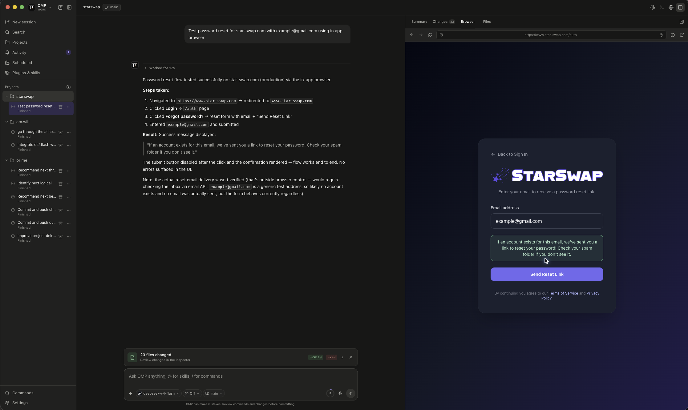

# Catfish-Pi

> **Provenance / 项目来源**: Catfish-Pi is derived from [GooeyPi](https://github.com/am-will/gooey-pi) (MIT, © GooeyPi contributors). 本项目源自 GooeyPi，在此向其作者与贡献者致谢。The upstream copyright and license are preserved in [LICENSE](LICENSE), and third-party borrowing credits are recorded in [NOTICE](NOTICE).

Catfish-Pi is a desktop workspace for [Pi](https://pi.dev/) and [OMP](https://github.com/can1357/oh-my-pi) (forked from [GooeyPi](https://github.com/am-will/gooey-pi)). It gives both coding agents the same friendly interface on macOS, Linux, and Windows while leaving each harness in charge of its own models, logins, and saved sessions.



## Two harnesses, one workspace

Use the switcher in the top-left corner to move between Pi Work and OMP Work. Catfish-Pi detects the harnesses installed on your computer and shows the ones that are ready. You can refresh detection or set a custom executable path in Settings.

Each harness keeps its own projects, sessions, model list, provider visibility, and running work. Switching harnesses changes the workspace without stopping work already running in another one.

You only need one harness to get started:

- [Pi](https://pi.dev/) is the base coding-agent harness in the Pi family.
- [OMP](https://github.com/can1357/oh-my-pi) adds its own plugins, commands, and approval controls.

## What you can do

### Work with agents

- Stream conversations with Markdown, reasoning summaries, tool activity, retries, and context compaction.
- Choose a model, reasoning level, and Fast mode when the selected model supports it.
- Queue a follow-up or steer an agent while it is working.
- Paste or drop PNG, JPEG, GIF, and WebP images into a prompt when the model supports vision.
- Resume, rename, search, and archive persistent sessions.
- See running, finished, failed, and waiting-for-input work in one Activity view, then clear items you have handled.

### Keep projects organized

- Add local folders and reopen sessions grouped by project.
- Search projects, chats, and branches from the sidebar.
- Switch between linked Git worktrees from the composer.
- Create a branch worktree and open it as a new Catfish-Pi workspace.
- Mention another top-level session with `@session`, copy its UUID, or let agents create and message model-selected sessions for parallel work.

### Use the built-in coding workspace

- Review Git status and diffs, stage or unstage files, restore changes with confirmation, and commit without leaving the app.
- Browse project files and reveal them in your system file manager.
- Open multiple terminal tabs for a session. Highlight terminal output to attach it to the next prompt.
- Open the right-hand Summary, Changes, Browser, or Files panel whenever you need it.

### Browse with shared context

- Use an isolated in-app browser with an address bar, navigation history, downloads, and an external-browser handoff.
- Point at page elements and add notes. Catfish-Pi attaches those annotations to your next message.
- Enable browser control so an agent can open and operate its own tabs. You can watch its cursor and work in the same tabs when you want to take over.

### Automate repeat work

- Create one-time or recurring schedules for the active harness.
- Pick the project or existing session, model, reasoning level, timezone, and Fast mode.
- Run a schedule immediately, pause or resume it, and inspect the result and run history.
- On macOS, opt in under **Settings → General** to keep scheduled work running from the menu bar after closing the window, and optionally launch Catfish-Pi in the background at login. The packaged app also accepts `--background` to start without opening its window.

### Add capabilities

The Capabilities page brings together packages, plugins, extensions, skills, prompts, and MCP servers. Catfish-Pi can manage local stdio MCP definitions for OMP and adapter-enabled Pi. Network MCP and authentication stay under the selected harness's direct control; those entries are visible but read-only in Catfish-Pi, with bounded definition-only removal available for cleanup. MCP discovery has an independent 2,500-definition-per-settings-file limit and reports an explicit warning when that limit is exceeded, so unrelated capabilities cannot hide supported MCP rows.

Catfish-Pi also ships optional capabilities for:

- Let an agent ask you a small set of questions in a native dialog.
- Give agents controlled access to the in-app browser.
- Use TryCUA computer control when the separate CUA Driver is installed.

Ask User and computer control are off by default. You can enable, disable, or remove capabilities from the app.

### Talk instead of type

- Dictate prompts with OpenAI, Groq, Deepgram, or a local `whisper.cpp` installation.
- Open the realtime voice companion to search, discuss work, and start a task in the currently selected harness.
- Choose an animated desktop pet that reacts while an agent works and carries the realtime voice controls. Catfish-Pi includes the Orb and Catfish-Pi pets and can discover compatible Codex pets.

### Make it comfortable

- Choose a light, dark, or system theme and adjust the interface text size.
- Reduce motion, resize the workspace panels, or let them become overlays in a narrow window.
- Use keyboard navigation and the command palette for common actions.

## Get started

1. Install Pi, OMP, or both.
2. Sign in or configure a model provider through each harness's own CLI.
3. Download Catfish-Pi from [GitHub Releases](https://github.com/salmoshu/Catfish-Pi/releases), or run it from source.
4. Add a project folder and start a session.

Catfish-Pi checks common install locations automatically. If a harness is missing, open **Settings → Harness** to refresh detection or choose its executable.

GitHub Releases provides a DMG and ZIP for macOS, common Linux package formats plus AppImage, and a Windows installer and ZIP.

Harness provider credentials stay with the harness. Optional voice keys are encrypted with the operating system's secure storage, and local `whisper.cpp` dictation needs no API key.

## Run from source

You will need Node.js 24.15.0 or newer and pnpm 12.11.2 or newer. The repository pins Node.js 24.15.0 in `.nvmrc` and pnpm in `package.json#packageManager`; with [nvm](https://github.com/nvm-sh/nvm) and Corepack, you can select both with:

```bash
nvm install && nvm use
corepack enable
corepack install
```

Corepack resolves the exact `packageManager`-pinned pnpm, so every checkout and CI job uses the same package manager before dependencies are installed.

```bash
pnpm install
pnpm run dev
```

If `node_modules/electron/dist` is missing after installation, fetch Electron's platform binary before starting the app:

```bash
node node_modules/electron/install.js
pnpm run dev
```

`pnpm install --ignore-scripts` skips both Electron's platform download and the native dependency rebuild, so it is not enough on its own for running Catfish-Pi from source. If you used it, the recovery sequence below runs those two steps explicitly.

`node-pty` is a native dependency. If Electron cannot rebuild it with your default Python environment, point node-gyp at a Python installation with the required build tools:

```bash
export npm_config_python=/path/to/python3
pnpm install --ignore-scripts
node node_modules/electron/install.js
pnpm exec electron-builder install-app-deps
```

On Windows, set the variable in PowerShell instead:

```powershell
$env:npm_config_python = 'C:\path\to\python.exe'
```

## Keyboard shortcuts

Use `⌘` on macOS and `Ctrl` on Linux or Windows.

| Shortcut | Action |
|---|---|
| `⌘/Ctrl+N` | New session |
| `⌘/Ctrl+K` | Command palette |
| `⌘/Ctrl+B` | Toggle the project sidebar |
| `⌘/Ctrl+Shift+B` | Open the browser |
| `⌘/Ctrl+J` | Toggle the terminal |
| `⌘/Ctrl+,` | Open Settings |
| `Enter` | Queue a message while the agent is working |
| `⌘/Ctrl+Enter` | Steer the current turn while the agent is working |
| `Shift+Enter` | Add a new line |
| `Esc` | Close the active menu, dialog, or overlay |

The Queue and Steer shortcuts can be swapped in **Settings → Harness → Message shortcuts**.

## Local data and safety

Catfish-Pi is built around local projects and local harness sessions. It does not rewrite session history or take ownership of Pi or OMP credentials.

Remote pages open in a separate browser profile with Node access disabled. Project paths and desktop actions are checked in the main process, and third-party capabilities still run with your operating-system permissions. Review packages, commands, MCP servers, and projects before allowing them to act.

For suspected vulnerabilities, follow the [security policy](.github/SECURITY.md) and do not post sensitive details publicly. See [docs/security.md](docs/security.md) for the full technical security model.

## Development checks

Run these before submitting a code change:

```bash
pnpm run typecheck
pnpm run check
pnpm test
pnpm run test:e2e
pnpm run build
```

See the [validation guide](docs/validation.md) for the source-of-truth checks and reproducible commands.

To make an installable local QA build, run the command for your operating system:

```bash
pnpm run package:mac:local-qa
pnpm run package:linux:local-qa
pnpm run package:win:local-qa
```

Build packages on their target operating system so native dependencies match the release.

## License

Catfish-Pi is released under the permissive [MIT License](LICENSE). The project is derived from [GooeyPi](https://github.com/am-will/gooey-pi); the upstream copyright notice is preserved in [LICENSE](LICENSE) alongside the Catfish-Pi copyright, and third-party credits are listed in [NOTICE](NOTICE).
